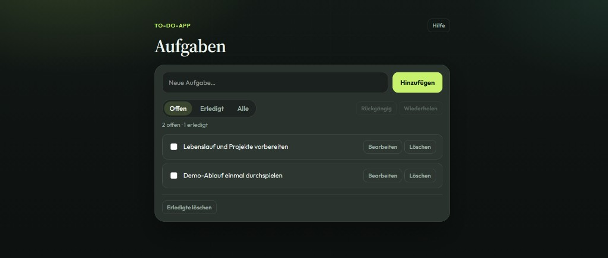

# To-Do-App

Präsentationsfähige To-Do-App mit React und Vite.

## Funktionen

- Aufgaben hinzufügen
- Bearbeiten und speichern
- Als erledigt markieren
- Löschen
- Filter: Offen (Standard) / Erledigt / Alle
- Erledigte auf einmal entfernen
- Rückgängig / Wiederholen (Strg+Z / Strg+Y)
- Persistenz über `localStorage`

## Start (Vorstellung)

- Start: Doppelklick auf `START` (Verknüpfung) — ohne CMD-Fenster
- Stopp: Doppelklick auf `STOP`
